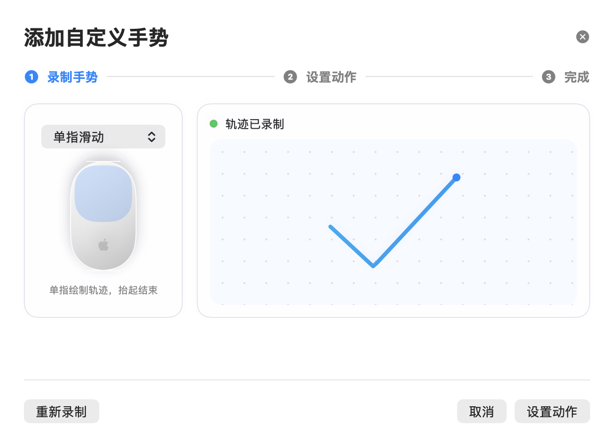

# 妙手势

妙手势是一款为 Apple 妙控鼠标（Magic Mouse）自定义手势的 macOS 菜单栏工具。默认双指上滑打开调度中心，下滑查看当前 App 的所有窗口。

## 安装

**当前正式版为 1.0.8**，适用于搭载 Apple 芯片、运行 macOS 13 或更高版本的 Mac。[下载正式版安装包](https://github.com/liyunxiang0913/MiaoShouShi/releases/tag/v1.0.8)

**本次更新**

修复了部分问题

### 首次安装

1. 打开上方的正式版下载页，在 Assets（附件）中下载 `.dmg` 安装包。
2. 双击 DMG，把「妙手势」拖入「应用程序」。复制完成后推出磁盘映像。
3. 在访达中打开「应用程序」，双击「妙手势」。启动后，点击 Mac 菜单栏里的妙手势图标，选择「手势设置…」。

### 首次打开时提示「无法验证开发者」

1.0.8 使用临时签名，未经 Apple 公证，首次启动时 macOS 可能会拦截。确认安装包来自本项目的 GitHub 正式版下载页且你信任此来源后，可按以下步骤打开。

1. 在「应用程序」里双击一次「妙手势」，看到验证提示后关闭弹窗。
2. 打开苹果菜单  →「系统设置」→「隐私与安全性」（部分版本显示为「隐私与安全」），向下找到「安全性」。
3. 在提到「妙手势」的拦截提示旁点击**「仍要打开」**，按系统提示确认身份，再点击「打开」。此操作只为妙手势添加例外。[Apple 关于首次打开 App 的说明](https://support.apple.com/zh-cn/102445)

### 首次授权

1. 在妙手势左侧点「通用设置」，找到「权限与辅助功能」。调整前台窗口和发送快捷键的手势会用到这里的权限。
2. 点击「打开辅助功能设置…」，在系统权限列表中打开「妙手势」旁的开关。如果列表里没有妙手势，点「＋」，从「应用程序」中选中「妙手势」并开启。
3. 返回妙手势，「当前状态」会自动刷新。若显示「辅助功能已授权，快捷键不可用」，点「请求快捷键授权…」并按系统提示允许。看到「已授权」后，连接妙控鼠标即可试用手势。

### 自动更新

「通用设置 → 自动更新」默认开启。妙手势在启动时和运行期间每 6 小时检查本项目的公开 GitHub Releases，发现更高的正式版本后自动下载 DMG。下载完成后，下次启动会安装新版，也可以点击「重启并安装」。关闭设置窗口会继续在菜单栏运行；退出并重新打开才会安装。

更新沿用当前 App 的安装位置，手势与偏好设置保存在原处。更新器核对 GitHub 提供的 SHA-256，再检查包内的应用签名、标识、版本和系统兼容性。使用 1.0.1 或更早版本的用户可以直接手动安装 1.0.8，之后即可接收自动更新。

临时签名版本升级后，macOS 可能要求重新授权。先在「通用设置」按当前状态提示授权。如果系统开关已打开，返回妙手势后仍提示缺少权限，展开「系统已允许，仍无法使用？」，点击「重新请求授权」，按提示允许当前版本。

## 功能清单

| 功能 | 可以做什么 |
| --- | --- |
| 鼠标电量（1.0.3） | 打开设置窗口，左侧连接卡片会自动刷新电量百分比，并显示「充电中」或「已充满」。 |
| 手势识别 | 双指张开和合拢可逐档缩放，双指上滑、下滑可分别绑定动作。自定义手势支持单指轻点、单指画轨迹，以及按住鼠标主键拖动。 |
| 窗口与桌面 | 打开调度中心、查看当前 App 的所有窗口、最大化前台窗口、显示桌面，或切换到左侧、右侧桌面。 |
| 系统与应用 | 打开聚焦搜索、展开或收起通知中心、截取屏幕、启动指定应用，或正向、反向切换 App。 |
| 快捷键与管理 | 录制自己的组合键并绑定到手势。内置手势可设为「不执行操作」，自定义手势可编辑、停用或删除。 |
| 菜单栏与偏好 | 关闭设置窗口后继续监听手势，支持开机启动、简体中文和英文，以及浅色、深色或跟随系统的外观。 |

1.0.3 换用了单色菜单栏图标，图标会随菜单栏底色自动切换明暗。点击图标即可打开手势设置。

## 双指开合缩放

在「手势设置 → 内置手势」中可以开关「双指开合缩放」，默认开启。1.0.4 将原来的「系统手势」分组更名为「内置手势」。先切换到要缩放的网页、图片或文档，再将两根手指轻放在鼠标表面，向两侧张开即可逐档放大，向内合拢即可逐档缩小。继续移动可再调一档，抬起手指结束。妙手势可以发送 ⌘= 和 ⌘− 缩放快捷键。当系统只允许辅助功能控制时，会尝试执行前台 App「显示」或「视图」菜单里的「放大」或「缩小」。两种方式均未获授权时，点击开关下方的「去授权…」，即可前往系统设置允许妙手势。授权生效后提示会自动收起。

## 试一试：画勾打开通知中心

1. 在「手势设置」点击「添加手势」，选择「单指滑动」，在鼠标表面画一个勾后抬起手指。
2. 核对预览中的轨迹，点击「设置动作」，给手势命名，选择「系统操作」中的「打开通知中心」。
3. 点击「下一步」和「完成」。再画一次勾即可打开通知中心，重复手势即可收起。

如果手势没有响应，先在「手势设置」查看鼠标连接状态和「最近识别」。如果手势已识别，但快捷键没有执行，请在「通用设置」中检查辅助功能权限。

更多操作请参阅[使用手册](docs/guide.md)。
